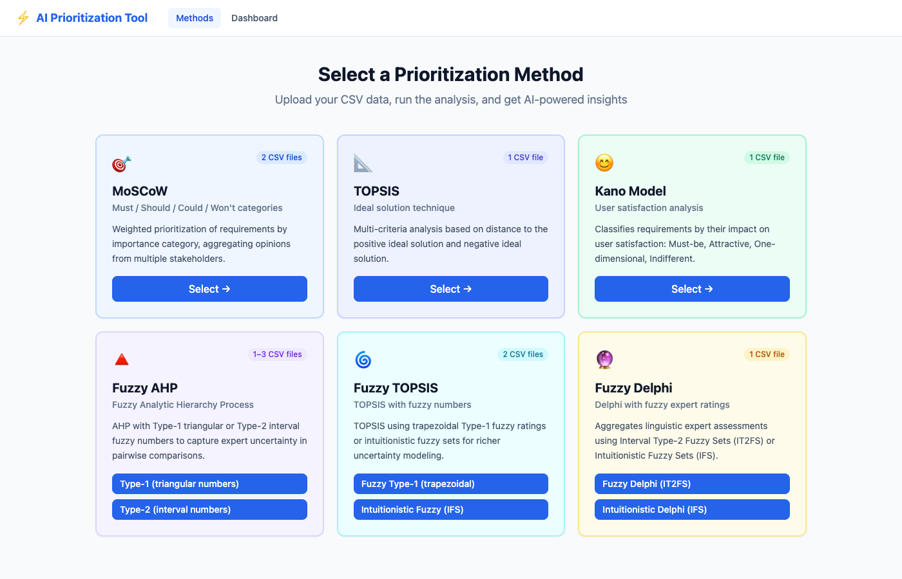
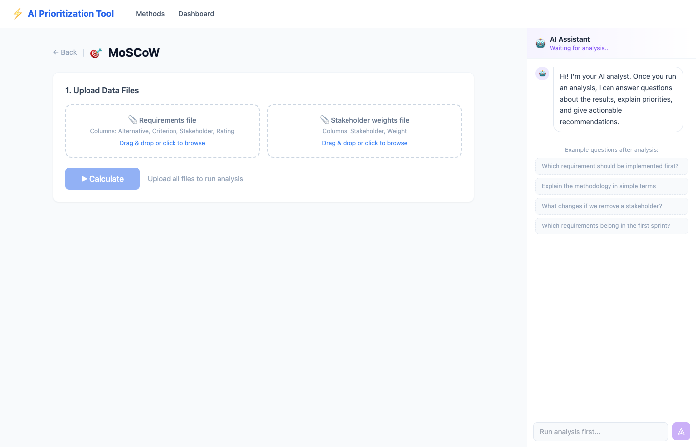
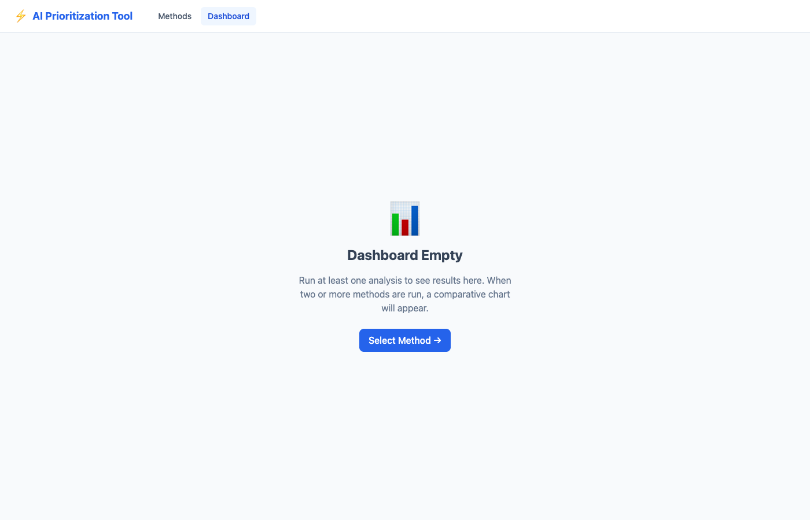

# AI-Enhanced Requirements Prioritization Tool

A web application for multi-criteria software requirements prioritization with an AI analytics layer. Supports six methods — MoSCoW, TOPSIS, Kano, Fuzzy AHP, Fuzzy TOPSIS, and Fuzzy Delphi — with automatic AI interpretation, stakeholder conflict detection, and a conversational assistant.

## Screenshots


*Home — select from six prioritization families, each showing the number of required CSV files*


*Analysis — drag-and-drop CSV upload with the AI chat panel ready on the right*


*Dashboard — once analyses are run, a comparative bar chart appears alongside a ranked results table*

## Features

- **Six prioritization methods** with nine algorithm variants
- **Drag-and-drop CSV upload** with per-method file guidance
- **Interactive charts** — color-coded horizontal bar charts per method
- **Comparative dashboard** — side-by-side bar chart when two or more methods are run
- **AI Interpretation** — automatic 3-4 sentence summary after every analysis
- **Conflict Detection** — identifies hard and soft stakeholder disagreements, with AI-generated root-cause and resolution advice
- **AI Chat** — streaming conversational assistant with full analysis context

## Tech Stack

| Layer | Technology |
|---|---|
| Backend | Python 3.9+, FastAPI, Uvicorn |
| Frontend | React 18, Vite, Tailwind CSS, Recharts |
| AI | Google Gemini 2.0 Flash (free tier) via REST |
| Session storage | In-memory (no database required) |

## Prerequisites

- Python 3.9+
- Node.js 18+
- A **free** Gemini API key from [aistudio.google.com/app/apikey](https://aistudio.google.com/app/apikey)

## Setup

### 1. Install backend dependencies

```bash
cd /path/to/prioritization_tool
.venv/bin/pip install fastapi "uvicorn[standard]" python-multipart certifi python-dotenv
```

Or activate the virtual environment first:

```bash
source .venv/bin/activate
pip install fastapi "uvicorn[standard]" python-multipart certifi python-dotenv
```

### 2. Install frontend dependencies

```bash
cd frontend
npm install
```

### 3. Set your API key

```bash
export GEMINI_API_KEY="AIzaSy..."
```

> The app works without a key — calculations run fully, only AI features are disabled.

## Running

```bash
export GEMINI_API_KEY="AIzaSy..."
./start.sh
```

| Service | URL |
|---|---|
| Frontend | http://localhost:5173 |
| Backend API | http://localhost:8000 |
| API docs (Swagger) | http://localhost:8000/docs |

## Supported Methods

| Method | Variants | Input files |
|---|---|---|
| **MoSCoW** | — | Requirements CSV + stakeholder weights CSV |
| **TOPSIS** | — | Single data CSV |
| **Kano Model** | — | Single data CSV |
| **Fuzzy AHP** | Type-1 (triangular), Type-2 (interval) | 1–3 CSV files |
| **Fuzzy TOPSIS** | Fuzzy Type-1 (trapezoidal), Intuitionistic (IFS) | Data CSV + scale CSV |
| **Fuzzy Delphi** | IT2FS, Intuitionistic (IFS) | Single data CSV |

Example CSV files for every method are in `prioritization_tool/assets/`.

## Project Structure

```
prioritization_tool/
├── backend/
│   ├── main.py                  # FastAPI app entry point
│   ├── requirements.txt
│   ├── routers/
│   │   ├── upload.py            # POST /api/upload
│   │   ├── analysis.py          # POST /api/analyze/{method}
│   │   └── ai.py                # AI interpretation, conflicts, chat
│   └── services/
│       ├── session.py           # In-memory session store
│       ├── ai_service.py        # Gemini REST calls (interpret, conflicts, stream chat)
│       └── logic_bridge.py      # Imports existing logic files without modification
├── frontend/
│   └── src/
│       ├── pages/
│       │   ├── Home.jsx         # Method selection cards
│       │   ├── Analysis.jsx     # File upload + results + AI block
│       │   └── Dashboard.jsx    # Multi-method comparison
│       └── components/
│           ├── ChatPanel.jsx    # Streaming AI chat sidebar
│           ├── ResultsChart.jsx # Horizontal bar chart
│           └── ConflictAlert.jsx# Expandable conflict cards
├── prioritization_tool/         # Original tkinter app (untouched)
│   └── logic/                   # Core algorithm files — not modified
│       ├── MoSCoW/
│       ├── TOPSIS/
│       ├── Kano/
│       ├── fuzzy_ahp.py
│       ├── fuzzy_topsis.py
│       ├── fuzzy_delphi.py
│       └── intuitionistic_topsis.py
└── start.sh                     # Starts both servers
```

## API Reference

| Method | Endpoint | Description |
|---|---|---|
| `POST` | `/api/upload` | Upload CSV files, returns `session_id` |
| `POST` | `/api/analyze/{method}` | Run analysis, returns results + conflicts |
| `POST` | `/api/ai/interpret` | Generate AI summary for session |
| `POST` | `/api/ai/conflicts` | Enrich conflicts with AI explanations |
| `POST` | `/api/ai/chat` | Streaming chat (SSE) |
| `GET` | `/api/session/{id}` | Retrieve session data |

## AI Quota

The free Gemini tier allows **1,500 requests/day** and **15 requests/minute**. The app gracefully degrades when the quota is reached — calculations continue to work normally, and AI blocks display a clear message instead of a technical error.
