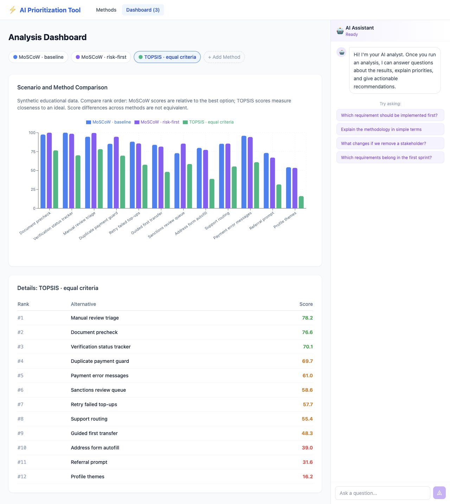

# Requirements Prioritization Tool

**Turn competing feature requests into a decision your team can explain.**

Compare priorities across Product, Operations and Risk, explore several ranking methods, and see how the shortlist changes when stakeholder influence shifts. Built with **Python, FastAPI and React** for product teams, analysts and software engineering students.

**Start here → [A quarter of onboarding improvements](examples/fintech-quarter/README.md)**
12 synthetic options, three stakeholder roles, a resource budget and a recommendation backed by reproducible calculations. An educational case, independent of any company.



## Quick start

Requires Python 3.10+ and Node.js 20.19+.

```bash
git clone https://github.com/vitoriofedorov15/prioritization_tool.git
cd prioritization_tool
python3 -m venv .venv
source .venv/bin/activate
python -m pip install -r backend/requirements-dev.txt
cp .env.example .env
cd frontend
npm ci
cd ..
./start.sh
```

Open **[localhost:5173](http://localhost:5173)** and click **Run fintech demo →**. The app uploads the included CSV files and runs three analyses through the backend. Click a scenario to inspect its ranked table.

**No Gemini API key is required.** Calculations, charts and the demo run locally. To enable the optional assistant, add your key to `.env` and restart. Session results live in memory; restarting the backend clears them, and refreshing the page clears its dashboard selection/history.

## What you can do

- Upload CSV assessments and stakeholder weights.
- Rank requirements with MoSCoW, TOPSIS, Kano and fuzzy methods.
- Compare scenarios and inspect stakeholder disagreement signals.
- Add optional Gemini summaries and contextual chat.

| Method family | Variants | CSV inputs |
|---|---|---|
| MoSCoW | Weighted category scoring | Requirements + stakeholder weights |
| TOPSIS | Numeric ideal-solution ranking | One data file |
| Kano | Satisfaction categories | One data file |
| Fuzzy AHP | Type-1, Type-2 | Three files for Type-1; one for Type-2 |
| Fuzzy TOPSIS | Trapezoidal, intuitionistic | Data + scale |
| Fuzzy Delphi | IT2FS, intuitionistic | One data file |

The onboarding case demonstrates MoSCoW and TOPSIS. Other input examples are in [`prioritization_tool/assets/`](prioritization_tool/assets/).

## Reproduce the case without a browser

From the repository root, with the virtual environment activated:

```bash
python examples/fintech-quarter/run_demo.py
```

This exercises multipart CSV upload, analysis and the no-key AI response using FastAPI's test client. It regenerates [`results.json`](examples/fintech-quarter/results.json) and the [complete ranking](examples/fintech-quarter/ranking.md). No external AI requests are made.

```bash
cd frontend
npm run build
```

## How the decision is represented

MoSCoW aggregates category assessments using stakeholder weights. Its score is normalized relative to the strongest option in that run. This TOPSIS implementation normalizes numeric columns, applies the CSV weight to each alternative's row, and calculates closeness to the ideal; all included criteria are treated as benefits. The case uses equal row weights and expresses effort as delivery ease.

Use **rank order and shortlist membership** when comparing these methods. Their displayed 0–100 scores have different meanings. The [case notes](examples/fintech-quarter/README.md) explain the inputs, assumptions and budget calculation.

## Architecture

```text
frontend/                       React, Vite, Tailwind, Recharts
backend/
  main.py                       FastAPI application
  routers/                      Upload, calculation, optional AI routes
  services/logic_bridge.py      Bridge to the original algorithms
  services/session.py           In-memory sessions
prioritization_tool/logic/      Original prioritization algorithms
examples/fintech-quarter/       Data, runnable case and results
start.sh                        Local backend + frontend launcher
```

The original Tkinter application is retained in `prioritization_tool/`; the quick start above runs the web application.

## API

Interactive documentation: **[localhost:8000/docs](http://localhost:8000/docs)**.

| Request | Purpose |
|---|---|
| `GET /api/health` | Service status |
| `POST /api/upload` | Multipart CSV upload; returns a session ID |
| `POST /api/analyze/{method}` | Run the selected calculation |
| `GET /api/session/{id}` | Retrieve results |
| `POST /api/ai/interpret` | Optional generated summary |
| `POST /api/ai/conflicts` | Optional disagreement explanations |
| `POST /api/ai/chat` | Optional streaming assistant |

For manual startup, run `.venv/bin/python -m uvicorn main:app --app-dir backend --host 127.0.0.1 --port 8000 --env-file .env`, then `npm run dev -- --host 127.0.0.1 --strictPort` from `frontend/`. The launcher checks that ports 8000 and 5173 are available and stops its own services on exit.
